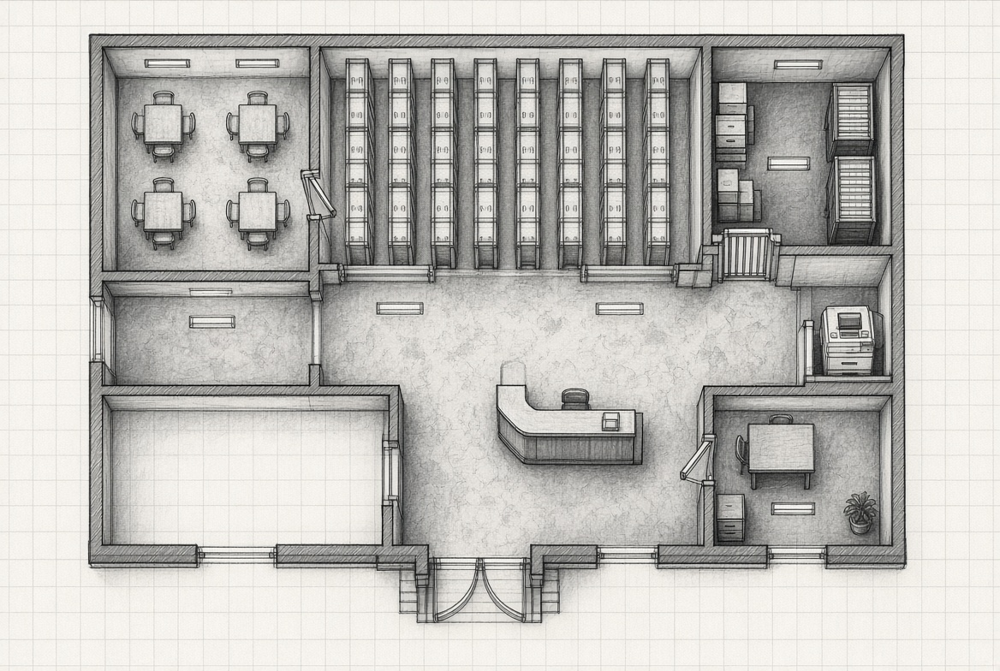
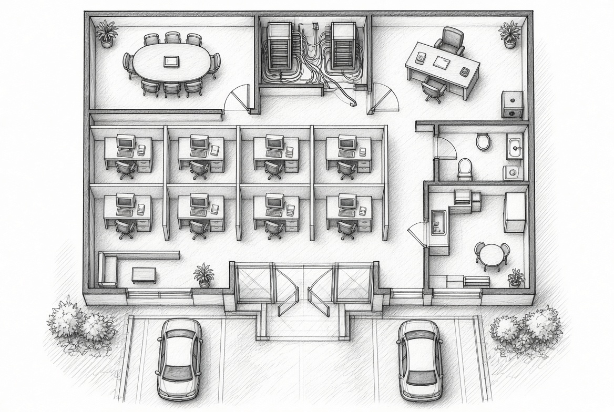
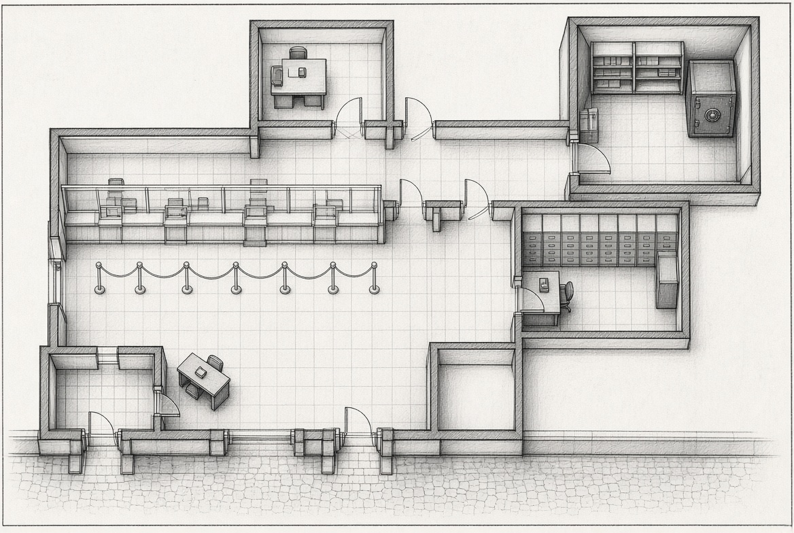
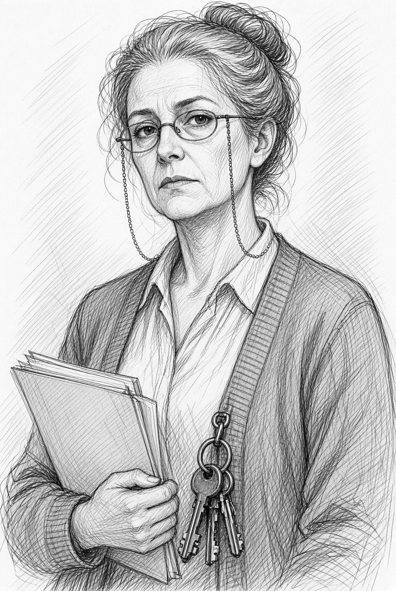
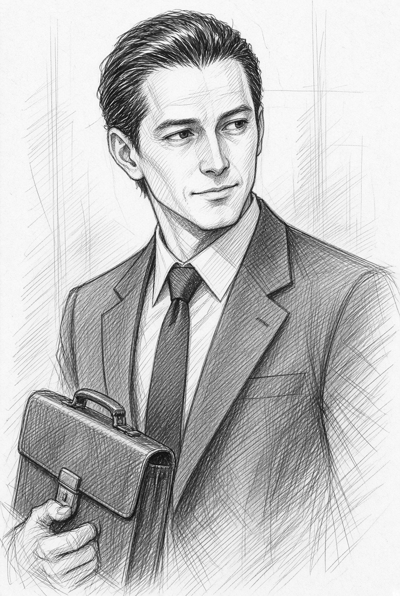
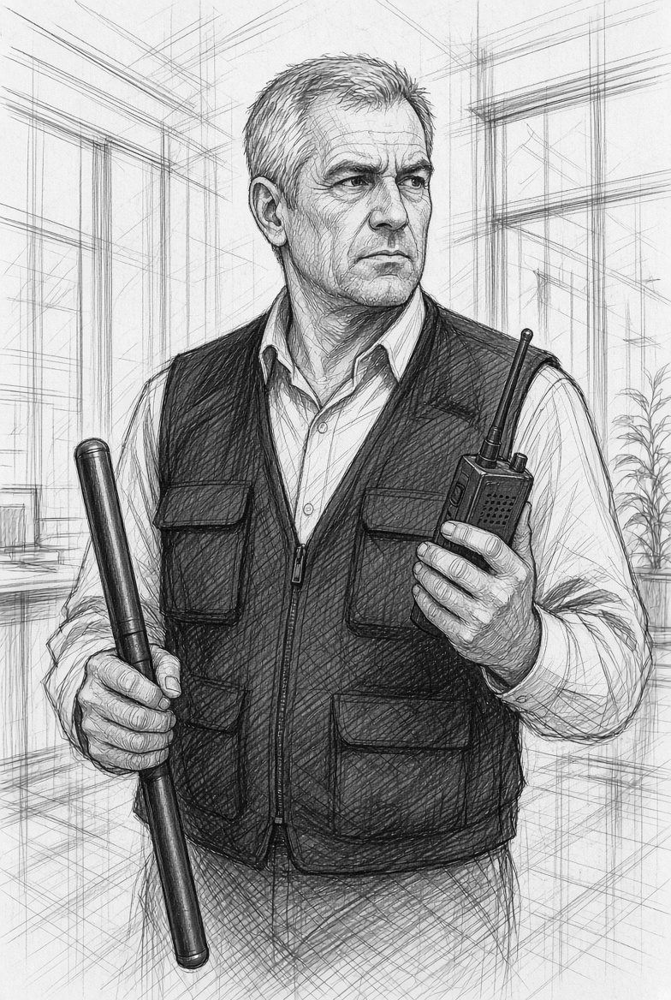

# Nexum en 1995

Windows 95 acaba de llegar a los escaparates, Red Hat 1.0 circula entre cuatro informáticos que se pasan discos como quien se pasa un secreto, y en las oficinas serias un Pentium a 133 MHz con dieciséis megas parece una máquina de otro planeta. Kaelyx Dynamics no vende futuro. Vende alivio: menos papel, menos colas, menos tardes perdidas en el archivo. A cambio, pide las llaves.

### Texto para leer en voz alta

Ha sido un verano de cajas nuevas y promesas viejas. En el ayuntamiento han cambiado los ordenadores, han tendido cables por los pasillos y han puesto un cartel que dice *modernización*, y Kaelyx Dynamics ha venido con traje claro y una sonrisa de comercial para explicar que ya no hará falta lidiar con tanto expediente, que ellos guardarán todo en un sitio solo, limpio, centralizado, y que el funcionario podrá irse a casa a una hora decente.

La comodidad entra fácil. Lo que no entra tan fácil es el papel que alguien dejó en un buzón, fotocopiado de malas ganas, con el membrete de Kaelyx Dynamics y un título que no debería haber salido nunca de sus despachos: **Memorando 66**. El texto está cortado, como si quien lo sacó hubiera tenido que correr, y aun así alcanza:

*Al ofrecer servicios de gestión documental centralizada a los ayuntamientos, tendremos control sobre esa información y podremos usarla para anticipar movimientos de suelo, contratos y deudas municipales, y orientar inversiones propias antes de que el mercado —o el votante— se entere.*

Kaelyx Dynamics dice que el documento es falso, que ellos jamás usarían esos datos de ninguna manera, que son una empresa de servicios y no una conspiración. El portavoz sale en una rueda de prensa breve, niega dos veces y sonríe como quien ya ha ganado. En el periódico local la nota cabe en un recuadro. En el bar, la gente encoge los hombros. En el archivo, sin embargo, hay quien ha visto las cintas de copia y sabe que las carpetas ya no están solo en el edificio.

Vosotros no os conocíais de antes, o apenas. Un hacker que entra de noche por un módem que silba como un animal enfermo. Una funcionaria que todavía ficha con tarjeta y conoce cada cajón del registro. Un policía que entiende de ordenadores lo justo para no dejarse tomar el pelo. Un periodista con una grabadora que come cintas y una libreta llena de nombres. Un fanático del software libre que mira Windows 95 como se mira a un ladrón bien vestido. El memorando os ha puesto en la misma mesa, y el peligro ya no es una teoría: es una empresa que quiere el padrón, el catastro y, más adelante, el gobierno entero.

Abajo, en la calle, una furgoneta gris espera con las luces apagadas. Arriba, en un despacho de Kaelyx Dynamics, alguien pide la lista de quien ha fotocopiado el 66.

### Qué pretende Kaelyx Dynamics (para el director, no para leer)

Primero, comodidad. Después, el archivo. Con el archivo, información privilegiada: suelo, contratos, deudas, padrones. Con eso, dinero. Con el dinero y con los datos de varios ayuntamientos, el paso siguiente no es un virus de película: es sentarse en la mesa donde se deciden gobiernos, saber antes quién cae y empujar. El Memorando 66 no habla de derrocar aún. Habla de *usar*. El derribo viene después, cuando el piloto municipal se convierta en contrato autonómico o ministerial.

### Cómo se juntan los cinco

La funcionaria encuentra el memorando en una bandeja que no es la suya, o se lo deja un compañero que al día siguiente pide la baja. El periodista recibe una copia anónima por fax. El hacker ve el mismo texto colgado a medias en un canal de IRC y reconoce el membrete. El policía abre una denuncia por “sustracción de documentación interna” que Kaelyx Dynamics ha presentado contra un desconocido. El del software libre reconoce, en la letra pequeña del contrato municipal, cláusulas que entregan copias de seguridad a servidores de la empresa. Ninguno tiene aún pruebas suficientes. Todos tienen la misma frase cortada y la misma mentira pública.

### Tecnología de mesa

Módem que ocupa la línea y se cae si alguien descoloca el teléfono. Disquetes que se corrompen si los acercas a un imán o a un mal cierre. Cintas DAT o QIC en un armario del sótano, con etiquetas de viernes. Virus de época, de los que pican el boot y te dejan el disco como un ladrillo. Red Hat 1.0 en un 486 prestado. Windows 95 en los PCs nuevos del ayuntamiento, todavía sin entenderse del todo con la red. Nada de nube. Todo cabe en una caja de zapatos.

### Apertura de la partida (primeros veinte minutos)

Están en un trastero o en el piso de uno de ellos. Sobre la mesa: el Memorando 66, un disquete sin etiqueta y un número de fax que ya no contesta. Suena el teléfono. Al otro lado, una voz que no se presenta dice que Kaelyx Dynamics ha pedido al ayuntamiento el listado de accesos al archivo de esta semana, y que el nombre de la funcionaria sale el primero.

Tres sitios a los que pueden ir, en el orden que quieran: el archivo municipal y sus cintas, la oficina de Kaelyx Dynamics en el polígono, donde de noche solo queda un vigilante y un 486 encendido.

Kaelyx Dynamics no es una mente. Es gente con traje, con furgoneta y con prisa por recoger el papel antes de que alguien complete la frase.

## Lugares

Tres paradas. Tres papeles distintos. Si falta uno, Nexum puede seguir sonriendo.

### Archivo municipal

Objetivo: **salir con prueba de que los datos ya no son solo del ayuntamiento**.

Concretamente: el listado de accesos de esta semana (el nombre de Teresa), el acta de cesión de copias a Nexum Data Management Solution firmada por Paco, y al menos una cinta o un disquete con un extracto real del padrón o del catastro marcado como *piloto*. Sin esto, el Memorando 66 es un texto. Con esto, es un robo de expediente.

## Oficina de Kaelix

Objetivo: **completar la frase cortada y demostrar que no es un bulo**.

Concretamente: el Memorando 66 entero, o la versión interna con membrete, fecha y destinatario; la lista de municipios “en cola”; y, si hay tiempo, la nota que habla de pasar del ayuntamiento al gobierno. Aquí no buscáis vecinos. Buscáis intención. Nexum puede negar un fax. Le cuesta más negar su propia carpeta.

### Sucursal del banco

Objetivo: **atar el documento a dinero y a nombres propios**.

En la sucursal el objetivo es concreto: el expediente de cliente del contrato de Nexum Data Management Solution, los pagos a la empresa y a esa “consultoría” que corre en paralelo, y un movimiento que el pleno nunca vio. Puede ser un anticipo, un pagaré o una transferencia a una sociedad que huele a suelo o al entorno de un concejal. El archivo muestra qué datos salieron del ayuntamiento. Kaelix muestra para qué los querían. El banco muestra quién cobra. Ese tercer papel es el que convierte la filtración en una trama con nombres y cantidades.

Podéis elegir el orden de las tres paradas. El reloj, en cambio, sigue una sola dirección: mañana hay rueda de prensa y las cintas salen del sótano. Una parada deja una sospecha. Dos dejan una noticia. Las tres dejan un relato que ya no pueden despachar con una sonrisa.

# Jefes enemigos

Tres jefes humanos, uno por parada. Las cifras de D&D son **piel**: usáis el bloque del *Manual de Monstruos* (5e) y le cambiáis el traje. No hay dragones en el archivo. Hay gente que pega duro y cierra puertas.

### Archivo municipal

**Jefa: Gloria Sanmartín**, jefa de archivo. Cincuenta años, llaves en el pecho, voz de quien ha expedientado a medio edificio. No busca mataros. Busca retrasaros hasta que llegue Nexum. Cierra compactos, corta la luz del depósito, llama por el interfono. Si la acorraláis, saca un palo de persiana o un cúter de apertura de cajas y pelea mal, pero en su terreno.

**Bloque D&D:** *Spy* (espía) para ella: lista, escurridiza, sabe cuándo huir. Si queréis que duela de verdad, subidla a *Veteran* (veterano) con la misma ficha social.

**Encuentros menores:** dos ordenanzas o un vigilante de noche = *Guard* (guardia). Un mastín de la portería = *Mastiff* (mastín).

### Oficina de Kaelix

**Jefe: Héctor Balaguer**, auditor de la delegación, maletín y dos escoltas. Quiere el 66 de vuelta y vuestra lista de nombres. Habla de abogados mientras los otros dos ocupan la sala. En el cuarto de servidores no duda: aquí hay dinero y hay delito.

**Bloque D&D:** Balaguer = *Bandit Captain* (capitán bandido) o *Noble* si preferís que pelee poco y mande mucho. Cada escolta = *Thug* (matón) o, si queréis el combate jodido, *Veteran*.

**Encuentros menores:** recepcionista que da la alarma = *Commoner* con un botón. Un técnico de sistemas acorralado que suelta un bat de apagado = *Scout* (explorador) con herramientas en vez de arco. Si alguien de Nexum viene “a limpiar”, *Assassin* (asesino) es el techo: usadlo solo una vez.

### Sucursal del banco

**Jefe: Elías Cano**, encargado de seguridad de la sucursal, exmilitar de destinos grises. Conoce la cámara, el botón del silencio y el tiempo que tarda la policía. No es de Nexum. Es de la caja. Si entráis fuera de hora, os trata como a atracadores. Si entráis con Emilio de paisano, duda un turno y luego elige bando.

**Bloque D&D:** Cano = *Veteran* o *Knight* (caballero) sin armadura reluciente: chaleco, porra, pistola de empresa.

**Encuentros menores:** cajero aterrado = *Commoner*. Vigilante de vestíbulo = *Guard*. Si hay un perro detrás del cristal = *Mastiff*. Un director de sucursal cobarde que se encierra con la carpeta = *Noble*.

### Resumen rápido para la carpeta del director

Archivo: Gloria (*Spy* / *Veteran*) + *Guard* + *Mastiff*.

Kaelix: Balaguer (*Bandit Captain*) + dos *Thug* o *Veteran*.

Banco: Cano (*Veteran* / *Knight*) + *Guard* + *Noble* en la trastienda.

Lo que **no** saquéis del manual, salvo como broma de una sola escena: muertos vivientes, limos, espectros, bárrogs. Rompen el tono de 1995. Si más adelante queréis un eco de Nexum futuro, ese es otro oneshot.

# Los jefes en detalle

Tres jefes, tres fichas, mismo tono que los PJ. Bloque D&D entre paréntesis para no inventar cifras nuevas.

### Gloria Sanmartín — jefa de archivo

Cincuenta años. Lleva más tiempo en el depósito que algunos concejales en el cargo. Las llaves le pesan en el pecho y la voz le sale ya de expediente. Firmó el contrato de Nexum Data Management Solution porque le prometieron menos papel y más orden. Ahora limpia pruebas y reza para que nadie abra la reja del fondo.

**Qué sabe hacer:** cerrar compactos, cortar la luz del depósito, llamar por el interfono y convertir una visita en un problema administrativo.

**Qué no sabe hacer:** disparar. Pelea con lo que hay: cúter de cajas, palo de persiana, una estantería que se viene encima.

**Qué quiere esta noche:** que salgáis sin cintas y sin el listado de accesos.

**Lleva encima:** llaves del archivo, gafas de cadena, un sello y el interfono.

**Defecto:** cree que el procedimiento la va a salvar a ella también.

**D&D:** *Spy*; si queréis que duela, *Veteran*. Ordenanzas: *Guard*. Perro de portería: *Mastiff*.

### Héctor Balaguer — auditor de Kaelix

Cuarenta y tres años. Traje que parece caro pero no lo es. Maletín. Sonrisa de rueda de prensa. Niega el Memorando 66 con la misma calma con la que pide vuestra lista de nombres. No se arriesga si puede evitarlo: para eso trae dos escoltas.

**Qué sabe hacer:** hablar, amenazar con abogados, ocupar una sala y decidir cuándo los otros dos se mueven.

**Qué no sabe hacer:** quedarse solo en el cuarto de servidores.

**Qué quiere esta noche:** el 66 de vuelta y que el piloto siga siendo un rumor.

**Lleva encima:** maletín, teléfono móvil antiguo, tarjeta de visita y una copia interna del contrato.

**Defecto:** si le rompéis la sonrisa, improvisa mal y se pone violento tarde.

**D&D:** *Bandit Captain* o *Noble* si pelea poco. Escoltas: *Thug* o *Veteran*.

### Elías Cano — seguridad de la sucursal

Cincuenta y dos años. Exmilitar de destinos que no salen en las fotos. Chaleco, porra, turno de cierre. Cobra de la caja. Si entráis de noche os ve como atracadores. Si Emilio enseña placa, duda un momento y luego elige.

**Qué sabe hacer:** leer una sala, usar el botón del silencio, saber cuántos minutos tarda un coche patrulla.

**Qué no sabe hacer:** distinguir rápido entre periodistas y ladrones cuando alguien grita.

**Qué quiere esta noche:** que la cámara no se abra sin orden. La carpeta NDMS es de la sucursal, no vuestra.

**Lleva encima:** porra, walkie, llave de la trastienda y un termo.

**Defecto:** el protocolo le puede más que la duda.

**D&D:** *Veteran* o *Knight* sin armadura. Vigilante de vestíbulo: *Guard*. Director encerrado: *Noble*.
